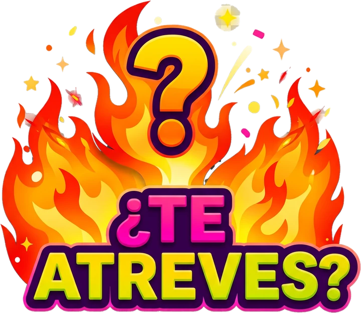

<p align="center">
  
</p>

<h1 align="center">¿Quién se atreve?</h1>

<p align="center">
  Juego de verdades y retos para amigos, pareja y universidad.
  <br>
  <b>Hecho por Digital Assets</b>
</p>

<p align="center">
  <a href="https://github.com/digitalassets-AI/Quien-se-atreve-/releases/latest">
    
  </a>
  <a href="https://github.com/digitalassets-AI/Quien-se-atreve-/actions/workflows/android.yml">
    
  </a>
  <a href="https://github.com/digitalassets-AI/Quien-se-atreve-/actions/workflows/ci.yml">
    
  </a>
  
  
  
  
  
</p>

> **Aviso:** contenido pensado para personas mayores de 18 años. Los retos son
> opcionales y siempre deben jugarse con respeto y consentimiento. **Digital
> Assets no se responsabiliza de nada** de lo que ocurra antes, durante o
> después del juego.

## Descargar con un QR

<p align="center">
  <a href="https://digitalassets-ai.github.io/Quien-se-atreve-/go/">
    
  </a>
</p>

Escanea el QR con la cámara del teléfono. El QR apunta a un enlace estable
(`/go/`) que redirige a la página de descarga: si algún día cambia la página,
solo se actualiza `app/go/index.html` y el QR impreso sigue funcionando.

La página detecta el sistema y muestra la descarga del APK en Android o la
instalación como PWA en iOS. En iPhone/iPad también puedes tocar **o jugar
aquí** para usar la app sin instalarla.

## Instalar en Android (APK)

En Android la distribución oficial es un **APK**. No es un acceso directo al
navegador: la app, el logo y los 1.210 ítems viajan dentro del archivo y
funcionan sin conexión.

El APK se versiona en `app/descargas/quien-se-atreve.apk` y se sirve desde
GitHub Pages, así que el enlace de descarga es estable y no depende de la API
de GitHub en tiempo de ejecución. Para actualizarlo tras publicar un release,
ejecuta `GH_TOKEN=... python3 tools/copy_apk.py` y haz commit del archivo.

1. Entra a **[Releases](https://github.com/digitalassets-AI/Quien-se-atreve-/releases/latest)**
   desde el teléfono.
2. Descarga el archivo `quien-se-atreve-v1.1.1.apk`.
3. Ábrelo desde la notificación o desde **Archivos → Descargas**.
4. Si Android lo solicita, permite **instalar apps desconocidas** para el
   navegador o el administrador de archivos que estés usando.
5. Toca **Instalar** y luego **Abrir**.

Requisitos y notas:

- **Android 6.0 (API 23) o superior.**
- No requiere Chrome, cuenta, registro ni conexión después de instalar.
- Para actualizar, descarga el APK nuevo e instálalo encima del anterior. La
  firma es la misma, así que se conservan los jugadores y el historial.
- Si desinstalas la app, Android borra sus datos locales.

## Instalar en iOS (iPhone/iPad)

iOS no puede abrir un APK: es un formato exclusivo de Android. En iPhone y iPad
la misma app se instala como **PWA desde Safari**, con el mismo contenido, los
mismos 1.210 ítems y funcionamiento sin conexión.

1. Abre **Safari** y entra a
   `https://digitalassets-ai.github.io/Quien-se-atreve-/`.
2. Toca el botón **Compartir** (el cuadrado con la flecha hacia arriba).
3. Elige **Agregar a pantalla de inicio**.
4. Confirma con **Agregar**.

La app queda con su icono, se abre a pantalla completa y funciona sin conexión
después de la primera carga. No requiere App Store, cuenta de Apple ni Mac.

> **¿Y una app nativa para la App Store?** Requiere una cuenta de Apple
> Developer (99 USD al año), un Mac con Xcode y firma con certificados de Apple.
> No forma parte de esta distribución; la PWA es la vía oficial y gratuita para
> iOS. La carpeta `app/` es exactamente el mismo contenido que se empaqueta en
> el APK.

## Tabla de contenido

- [Instalar en Android (APK)](#instalar-en-android-apk)
- [Instalar en iOS (iPhone/iPad)](#instalar-en-ios-iphoneipad)
- [¿Qué es?](#qué-es)
- [Características](#características)
- [Contenido](#contenido)
- [Arquitectura](#arquitectura)
- [Desarrollo](#desarrollo)
- [Compilar el APK](#compilar-el-apk)
- [Firma y actualizaciones](#firma-y-actualizaciones)
- [Publicar una versión](#publicar-una-versión)
- [CI/CD](#cicd)
- [Modelo de ramas](#modelo-de-ramas)
- [Base de datos](#base-de-datos)
- [Privacidad y seguridad](#privacidad-y-seguridad)
- [Contribuir](#contribuir)
- [Licencia y créditos](#licencia-y-créditos)

## ¿Qué es?

Una app para **Android e iOS** con **1.210 verdades y retos** repartidos en tres
categorías y nueve subcategorías. En Android el contenido se empaqueta dentro
del APK con [Capacitor](https://capacitorjs.com/) y se ejecuta en un WebView
local. En iOS se instala como PWA desde Safari. En ambos casos funciona sin
servidor y sin depender de una página externa.

- **Amigos:** panas, mejores amigos y amigos 🔥
- **Pareja:** conocerse, conocerse a fondo y pareja 🔥
- **Universidad:** compañeros, amigos de la U y universidad 🔥
- Tres modos: **💬 Preguntas**, **🔥 Retos** y **🎲 Aleatorio**
- Cambio de modo desde la pantalla del giro, sin salir de la partida
- Jugadores guardados, saltos por jugador y botella animada
- Historial anti-repetición persistente y botón para reiniciarlo
- Glosario integrado para las palabras menos comunes

## Características

| Característica | Detalle |
|---|---|
| Distribución | APK Android firmado + PWA instalable en iOS |
| Empaquetado | Capacitor 7 + WebView local en Android; PWA en iOS |
| Offline | Contenido empaquetado en el APK o cacheado por el service worker |
| Sin backend | No hay cuentas, servidor ni base de datos remota |
| Persistencia | `localStorage`: jugadores, partida e historial |
| Anti-repetición | Historial global por texto base, persistente |
| Responsive | Diseñada para teléfonos, tablets y escritorio |
| Privacidad | Sin analítica, sin cuentas y sin envío de datos |
| Versión web/PWA | `app/` se publica en GitHub Pages; es la instalación para iOS |

## Contenido

| Categoría   | Subcategoría       | Ítems | Origen                    |
|-------------|--------------------|:-----:|---------------------------|
| Amigos      | panas              |  100  | `data/extra/panas.csv`    |
| Amigos      | mejores_amigos     |  100  | `data/extra/mejores_amigos.csv` |
| Amigos      | amigos_hot         |  210  | Base de datos             |
| Pareja      | conocerse          |  100  | `data/extra/conocerse.csv` |
| Pareja      | conocerse_fondo    |  100  | `data/extra/conocerse_fondo.csv` |
| Pareja      | pareja_hot         |  210  | Base de datos             |
| Universidad | universidad_hot    |  190  | Base de datos             |
| Universidad | companeros         |  100  | `data/extra/companeros.csv` |
| Universidad | amigos_u           |  100  | `data/extra/amigos_u.csv` |
| **Total**   |                    | **1.210** | 610 hot + 600 no-hot  |

- **605 preguntas + 605 retos** en el HTML final.
- Cero duplicados exactos entre los 1.210 textos visibles.
- Cada nodo no-hot tiene 50 preguntas y 50 retos.
- El contenido hot se reparte en 4 niveles por juego.
- Los textos con variante de género usan `["base", "hombre", "mujer"]` y se
  resuelven según el jugador.

## Arquitectura

```text
Quien-se-atreve-/
├── app/                         # Web assets del APK y de la PWA de iOS
│   ├── index.html               # App final, autónoma y con el logo incrustado
│   ├── descargar.html           # Página de descarga según Android o iOS
│   ├── go/index.html            # Redirección estable del QR dinámico
│   ├── qr-descarga.png          # QR único (apunta a /go/)
│   ├── descargas/               # APK del último release (versionado)
│   ├── manifest.webmanifest     # Manifiesto PWA (iOS y navegador)
│   ├── sw.js                    # Service worker para uso sin conexión
│   └── icons/                   # Iconos de la PWA y de iOS
├── assets/
│   └── logo.webp                # Logo original con transparencia
├── data/
│   ├── hot/                     # 12 CSV (4 niveles × 3 juegos)
│   ├── extra/                   # 6 CSV de los nodos no-hot
│   └── glosario.csv             # Glosario opcional (la app usa el de la interfaz)
├── database/
│   └── quien_se_atreve.sqlite   # Única base de datos del proyecto
├── src/
│   └── interfaz_base.html       # Plantilla editable de la interfaz
├── tools/
│   ├── build.py                 # Reconstruye BD + app
│   ├── crear_bd.py              # CSV → SQLite
│   ├── montar_interfaz.py       # SQLite + CSV + logo → app/index.html
│   ├── make_icons.py            # Genera los iconos web desde el logo
│   ├── make_qr.py               # Genera el QR único de descarga
│   ├── copy_apk.py              # Copia el APK del release a app/descargas/
│   ├── make_android_assets.py   # Genera iconos y splash de Android
│   ├── prepare_android.py       # Nombre, versión, orientación y firma
│   ├── verify.py                # Verifica BD, web, APK y archivos
│   ├── verify.js                # Verifica los 1.210 ítems finales
│   └── requirements.txt         # Pillow, NumPy y Segno para imágenes y QR
├── .github/
│   ├── workflows/
│   │   ├── ci.yml               # Verificación del contenido
│   │   ├── android.yml          # Build y Release del APK
│   │   └── pages.yml            # Publica la PWA y el APK en GitHub Pages
│   ├── ISSUE_TEMPLATE/
│   └── pull_request_template.md
├── capacitor.config.json        # Configuración de Capacitor
├── package.json                 # Dependencias del empaquetado Android
├── CHANGELOG.md
├── CODE_OF_CONDUCT.md
├── CONTRIBUTING.md
├── LICENSE
├── README.md
└── SECURITY.md
```

`android/` y `android-assets/` **no se versionan**: se generan durante el build.
El APK final se descarga desde **Releases**, no desde el código fuente.

## Desarrollo

Requisitos para trabajar con el contenido y la vista web:

- **Python 3.10+**
- **Node.js 20+** (probado con Node 22)
- **Pillow** y **NumPy** solo si se regeneran imágenes

```bash
# Reconstruir la base de datos y la app final
python3 tools/build.py

# Verificar integridad, contenido y configuración de Android
python3 tools/verify.py
node tools/verify.js

# Regenerar iconos web si cambia el logo
python3 -m pip install -r tools/requirements.txt
python3 tools/make_icons.py
```

Para probar la vista web en local:

```bash
cd app
python3 -m http.server 8765
# Abre http://localhost:8765
```

La vista web necesita `http://` o `https://` para registrar el service worker.
Dentro del APK no se registra service worker: los archivos ya están empaquetados
y el juego funciona offline de forma nativa.

## Compilar el APK

El build local necesita **JDK 21** y el **Android SDK 35**. Android Studio no es
obligatorio si ya tienes el SDK y Gradle.

```bash
npm install

# Crear el proyecto Android y copiar los web assets
npx cap add android
npx cap sync android

# Generar iconos y splash desde assets/logo.webp
python3 -m pip install -r tools/requirements.txt
python3 tools/make_android_assets.py
cp -R android-assets/. android/app/src/main/res/

# Nombre, versión, orientación y colores del sistema
python3 tools/prepare_android.py

# APK de depuración (instalable, pero sin firma de producción)
cd android
./gradlew assembleDebug
```

El APK de depuración queda en:

```text
android/app/build/outputs/apk/debug/app-debug.apk
```

Para un build de producción firmado, define las variables y coloca la clave:

```bash
export ANDROID_KEYSTORE_PASSWORD="..."
export ANDROID_KEY_ALIAS="digitalassets"
export ANDROID_KEY_PASSWORD="..."

cp /ruta/segura/release-key.p12 android/app/release-key.p12
python3 tools/prepare_android.py
cd android
./gradlew assembleRelease
```

El APK firmado queda en:

```text
android/app/build/outputs/apk/release/app-release.apk
```

> No versiones `android/`, `release-key.p12`, `*.jks`, `*.keystore` ni las
> contraseñas. El `.gitignore` ya excluye esos archivos.

## Firma y actualizaciones

El workflow de GitHub Actions firma el APK de producción con una clave estable
guardada en **Settings → Secrets and variables → Actions**:

| Secreto | Contenido |
|---|---|
| `ANDROID_KEYSTORE_BASE64` | Keystore PKCS12 codificado en Base64 |
| `ANDROID_KEYSTORE_PASSWORD` | Contraseña del keystore |
| `ANDROID_KEY_ALIAS` | Alias de la clave (`digitalassets`) |
| `ANDROID_KEY_PASSWORD` | Contraseña de la clave |

La clave es la misma en cada versión. Eso permite instalar una actualización
encima de la app anterior sin desinstalarla y conservar los datos. Si la clave
se pierde o se cambia, Android rechazará la actualización por diferencia de
firma; en ese caso habría que desinstalar la versión anterior.

**No borres esos secretos.** Si necesitas rotar la firma, planifica una nueva
instalación limpia o un cambio de `appId`.

## Publicar una versión

1. Actualiza el contenido y reconstruye:

   ```bash
   python3 tools/build.py
   python3 tools/verify.py
   node tools/verify.js
   ```

2. Sube la versión en `package.json` y documenta el cambio en `CHANGELOG.md`.
3. Haz commit y crea el tag:

   ```bash
   git add .
   git commit -m "release: preparar 1.1.1"
   git tag -a v1.1.1 -m "Versión 1.1.1"
   git push origin main --tags
   ```

4. El workflow **Android APK** se ejecuta con el tag, compila el APK firmado y
   crea la Release con el archivo descargable.
5. Cuando termine el release, actualiza el APK que se sirve desde Pages:

   ```bash
   GH_TOKEN=... python3 tools/copy_apk.py
   git add app/descargas/quien-se-atreve.apk
   git commit -m "chore(web): actualizar APK de Pages"
   git push origin main
   ```

   El push vuelve a desplegar GitHub Pages con el APK nuevo.

El `versionCode` se calcula a partir del tag: `v1.1.0 → 10100`,
`v1.1.1 → 10101`, `v1.2.0 → 10200`. Debe ser siempre mayor que el anterior.

También puedes ejecutar el workflow manualmente desde **Actions → Android APK →
Run workflow** para probar el build. En ese caso se sube como artifact, pero no
se crea una Release.

## CI/CD

| Workflow | Cuándo se ejecuta | Qué hace |
|---|---|---|
| `ci.yml` | Push a `main`/`develop` y Pull Requests | Reconstruye, verifica contenido y comprueba que `app/index.html` esté actualizado |
| `android.yml` | Tags `v*` y ejecución manual | Crea el proyecto Capacitor, genera iconos/splash, firma y publica el APK |
| `pages.yml` | Push a `main` o ejecución manual | Publica `app/` (PWA y APK) en GitHub Pages |

Comandos que ejecuta el CI:

```bash
python3 tools/build.py
python3 tools/verify.py
node tools/verify.js
git diff --exit-code -- app
```

El workflow de Android requiere los cuatro secretos de firma. Sin ellos, el
build de producción se detiene con un mensaje claro; para pruebas locales usa
`./gradlew assembleDebug`.

### Proteger `main`

En **Settings → Branches → Add branch protection rule**:

1. Patrón: `main`.
2. Activar **Require a pull request before merging**.
3. Activar **Require status checks to pass** y seleccionar **CI / Verify**.
4. Activar **Do not allow bypassing the above settings**.

## Modelo de ramas

Mientras la app se distribuya desde una sola línea, `main` es la rama de
producción. Cuando empiecen las actualizaciones se activará el flujo completo:

| Rama | Propósito | ¿Publica APK? |
|---|---|:---:|
| `main` | Producción estable y tags | ✅ Sí |
| `develop` | Integración de la próxima versión | ❌ No |
| `feature/*` | Nuevas funciones o contenido | ❌ No |
| `fix/*` | Correcciones no urgentes | ❌ No |
| `release/*` | Preparación de una versión | ❌ No |
| `hotfix/*` | Corrección urgente desde `main` | Al mergear a `main` |

```text
main ───●──────────────●──────────────●───▶
         \            /              /
develop   ●──●──●──●──●──●──●──●──●──●───▶
             \     /     \     /
feature/*     ●───●       ●───●
```

Reglas:

1. Nadie trabaja directamente sobre `main`.
2. Toda función nace de `develop` en `feature/<nombre>`.
3. Todo cambio entra por **Pull Request** y debe pasar el CI.
4. `develop` se integra a `main` solo para publicar una versión.
5. Los tags de versión se crean sobre `main` (`v1.0.0`, `v1.1.0`, ...).

## Base de datos

`database/quien_se_atreve.sqlite` contiene:

- `juegos(id, nombre, descripcion)`
- `niveles(juego, nivel, nombre)`
- `preguntas(id, juego, nivel, tipo, texto, genero, texto_hombre, texto_mujer, significado)`
- `glosario(termino, definicion, categoria, ejemplo)`
- `nodos_extra(categoria, subcategoria, tipo, texto)`
- Vista `preguntas_azar` e índices por `(juego, nivel, tipo)`

Conteos: **610** filas hot en `preguntas`, **600** en `nodos_extra` y **0**
términos en `glosario`. `tipo` es `verdad` o `reto`.

Consulta rápida:

```bash
sqlite3 database/quien_se_atreve.sqlite \
  "SELECT juego, nivel, tipo, COUNT(*) FROM preguntas GROUP BY 1,2,3;"
```

Los CSV de `data/` son la fuente editable. `database/quien_se_atreve.sqlite` se
genera desde ellos y `app/index.html` se monta con el contenido incrustado. No
hay bases de datos duplicadas.

## Privacidad y seguridad

La app no recopila datos personales, no usa analítica y no envía información a
ningún servidor. Los jugadores y el historial se guardan únicamente en
`localStorage`, dentro del WebView del APK.

Para reportar una vulnerabilidad, usa **Security → Report a vulnerability** en
GitHub. No publiques tokens, credenciales, keystores ni datos personales en
issues o Pull Requests. Más detalles en [`SECURITY.md`](SECURITY.md).

## Contribuir

Lee [`CONTRIBUTING.md`](CONTRIBUTING.md) para el flujo de ramas, la convención de
commits y la checklist de Pull Request. Todas las contribuciones deben respetar
el [`CODE_OF_CONDUCT.md`](CODE_OF_CONDUCT.md).

## Licencia y créditos

El código se distribuye bajo licencia **MIT** (ver [`LICENSE`](LICENSE)). El
nombre **¿Quién se atreve?**, el logo y los textos del juego son propiedad de
**Digital Assets** y no se incluyen en esa licencia.

Hecho por **Digital Assets**.
